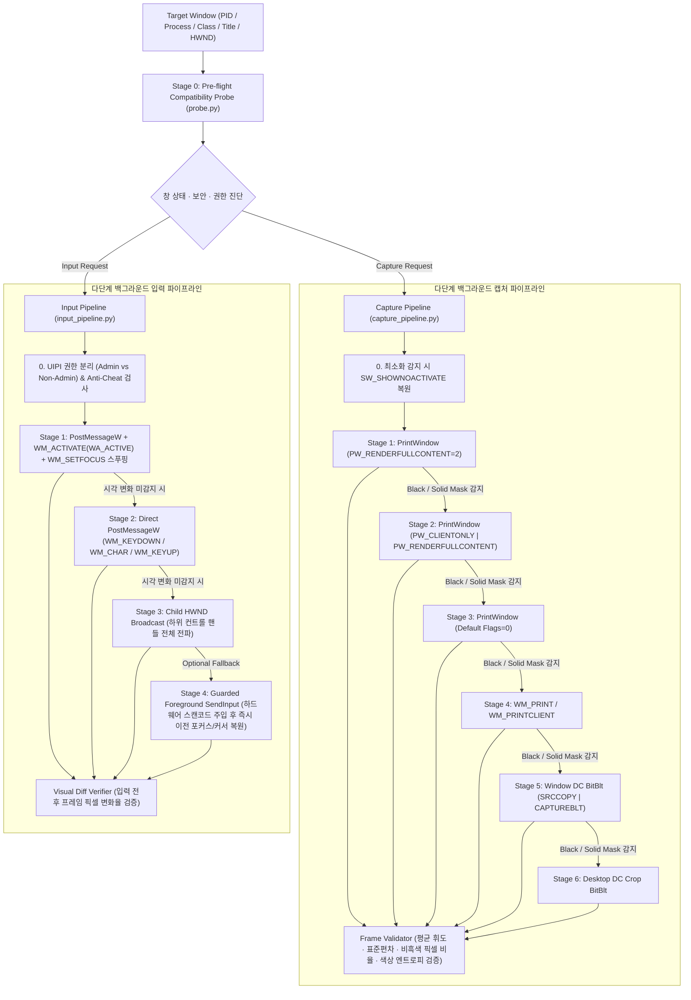

# win-bg-pipeline

**Windows 백그라운드 화면 캡처 및 비활성 입력 다단계 폴백 파이프라인 (Multi-Stage Background Screen Capture & Input Automation Pipeline)**

단일 API(`PrintWindow` 또는 `PostMessageW`)만 호출할 때 발생하는 **검은 화면 캡처(Exclusive Fullscreen, 창 최소화, `SetWindowDisplayAffinity` 보안 마스킹)** 및 **비활성 입력 무시(DirectInput/Raw Input 폴링, `GetForegroundWindow` 검사, UIPI 권한 분리, 안티치트)** 문제를 사전 진단(Pre-flight Probe)하고 다단계 폴백(Cascading Fallback)과 프레임 시각 검증(Visual Diff Verification)으로 해결하는 파이프라인 엔진입니다.

---

## 1. 아키텍처 및 파이프라인 구조



---

## 2. 작동 조건 및 파이프라인 대응 매트릭스

### 2.1 백그라운드 화면 캡처 (`CapturePipeline`)

| 환경 / 조건 | 기본 `PrintWindow(2)` 작동 여부 | 원인 | 파이프라인 대응 방식 |
| :--- | :---: | :--- | :--- |
| **일반 앱 (Win32, WPF, Electron, 브라우저)** | ✅ 작동 | DWM이 리다이렉션 표면을 합성 | `Stage 1 (PW_RENDERFULLCONTENT)` 즉시 캡처 및 유효성 통과 |
| **창 모드 / 테두리 없는 창 모드 게임 (DirectX/Vulkan, D2R 등)** | ✅ 작동 | DWM이 백버퍼를 합성 | `Stage 1 (PW_RENDERFULLCONTENT)` 캡처 후 휘도·표준편차 검증 |
| **창 최소화 (`WS_MINIMIZE` / `IsIconic`)** | ❌ 실패 (갱신 정지/검은 화면) | OS가 최소화된 창의 렌더링 중단 | `Pre-flight Probe`에서 감지 후 포커스를 뺏지 않는 `SW_SHOWNOACTIVATE`로 복원 뒤 캡처 |
| **배타적 전체화면 (Exclusive Fullscreen)** | ❌ 실패 (검은 화면) | DWM을 우회해 모니터에 직접 출력 | `FrameValidator`가 흑색 프레임(`non_black_ratio < 0.005`)을 자동 기각하고 하위 Stage(`Desktop DC BitBlt`)로 폴백 및 창 모드 전환 경고 발행 |
| **캡처 방지 보안 (`SetWindowDisplayAffinity`)** | ❌ 실패 (검은색 마스킹) | 금융·DRM 창에 `WDA_MONITOR` / `WDA_EXCLUDEFROMCAPTURE` 설정 | `GetWindowDisplayAffinity`로 사전 검출하여 `capture_protected=True` 진단 리포트 즉시 반환 |

### 2.2 백그라운드 키·마우스 입력 (`InputPipeline`)

| 환경 / 조건 | 기본 `PostMessageW` 작동 여부 | 원인 | 파이프라인 대응 방식 |
| :--- | :---: | :---: | :--- |
| **표준 `WndProc` 메시지 큐 수신 앱 (D2R UI 패널·단축키 등)** | ✅ 작동 | `WM_KEYDOWN`, `WM_CHAR`, `WM_LBUTTONDOWN` 직접 처리 | `Stage 1~2` 하드웨어 스캔코드(`MapVirtualKeyW`)가 패킹된 `lParam`으로 전송 |
| **단순 비활성 입력 무시 창** | ⚠️ 일부 무시 | 비활성 상태일 때 `WM_KEYDOWN` 무시 | `Stage 1`에서 `WM_ACTIVATE(WA_ACTIVE)` + `WM_SETFOCUS` 선행 주입 |
| **다중 계층 자식 창 (CEF, 중첩 컨트롤)** | ❌ 최상위 HWND만 전송 시 무시 | 실제 입력 루프가 자식 `HWND`에 위치 | `Stage 3 (child_hwnd_broadcast)`가 `EnumChildWindows`로 모든 자식 핸들에 전파 |
| **DirectInput / Raw Input / `GetAsyncKeyState` 폴링 및 `GetForegroundWindow` 대조** | ❌ 무시됨 | OS 메시지 큐를 거치지 않고 하드웨어 버퍼를 직접 폴링하거나 실제 포커스 대조 | `probe`에서 `dinput8.dll`/`xinput`/`hid.dll` 로드 여부를 사전 탐지하고, 필요 시 `Stage 4 (foreground_sendinput_restore_guard)`로 40ms 동안만 포커스 전환 후 하드웨어 스캔코드 `SendInput` 주입 뒤 원래 작업 창과 마우스 좌표를 즉시 복원 |
| **권한 분리 (UIPI) 및 커널 안티치트 (EAC, BattlEye, Vanguard 등)** | ❌ 차단됨 | 관리자 권한 창에 일반 권한 프로세스가 메시지 전송 불가(UIPI) / 커널 드라이버 차단 | `OpenProcessToken`(`TokenElevation`) 비교로 `uipi_blocked` 여부를 사전 판별하고 실행 중인 안티치트 프로세스를 진단 리포트에 기록 |

---

## 3. 설치 및 CLI 사용법

### 설치

```bash
pip install -e .
```

### 1) 실행 중인 창 목록 조회 (`list`)

```bash
python -m win_bg_pipeline list
python -m win_bg_pipeline list --process D2R.exe
```

### 2) 대상 창 호환성 사전 진단 (`probe`)

대상 창의 렌더링 모드(창 모드/전체화면/최소화), `GetWindowDisplayAffinity` 캡처 보안 마스킹 여부, UIPI 관리자 권한 불일치 여부, 로드된 그래픽/입력 DLL(`d3d12.dll`, `dinput8.dll`, `xinput` 등), 안티치트 프로세스를 한 번에 진단합니다.

```bash
python -m win_bg_pipeline probe --process D2R.exe --class-name OsWindow
```

### 3) 다단계 백그라운드 캡처 (`capture`)

```bash
python -m win_bg_pipeline capture --process D2R.exe --class-name OsWindow --out captures/screen.png
```

### 4) 다단계 백그라운드 키·마우스 입력 및 시각 검증 (`input`)

`--verify` 옵션을 켜면 키 전송 전후 프레임을 백그라운드 캡처하여 실제로 화면(UI 패널 열림 등)이 변했는지 픽셀 변화율(`visual_diff_ratio`)로 자동 검증합니다.

```bash
# 백그라운드 키 전송 + 화면 변화 검증
python -m win_bg_pipeline input --process D2R.exe --class-name OsWindow --key Q --verify

# 백그라운드 마우스 클라이언트 좌표 클릭
python -m win_bg_pipeline input --process D2R.exe --class-name OsWindow --click 450,300 --button left

# 백그라운드 문자열 타이핑 (WM_CHAR)
python -m win_bg_pipeline input --process notepad.exe --text "Hello Background Pipeline"
```

### 5) 선언형 JSON 파이프라인 일괄 실행 (`run`)

[`examples/d2r_hud_pipeline.json`](./examples/d2r_hud_pipeline.json)처럼 캡처·키 입력·시각 검증·대기 단계를 JSON으로 정의해 실행하고 실행 영수증(`receipt_output`)을 생성합니다.

```bash
python -m win_bg_pipeline run examples/d2r_hud_pipeline.json
```

---

## 4. 테스트 실행

실제 백그라운드 Win32 테스트 창을 띄워 포커스를 뺏지 않은 상태로 사전 진단(`probe`), 검은 화면/단색 마스킹 기각 검증(`FrameValidator`), 백그라운드 캡처(`CapturePipeline`), 백그라운드 키 입력 및 시각 변화율 검증(`InputPipeline`), 선언형 워크플로(`BackgroundOrchestrator`)를 검증합니다.

```bash
python -m unittest discover -s tests -v
```
